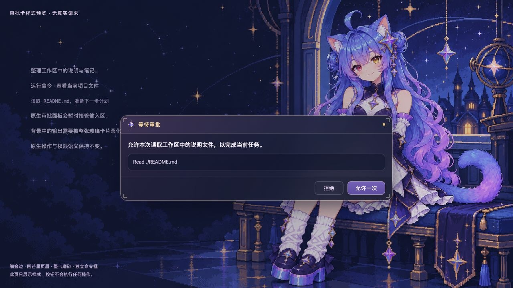
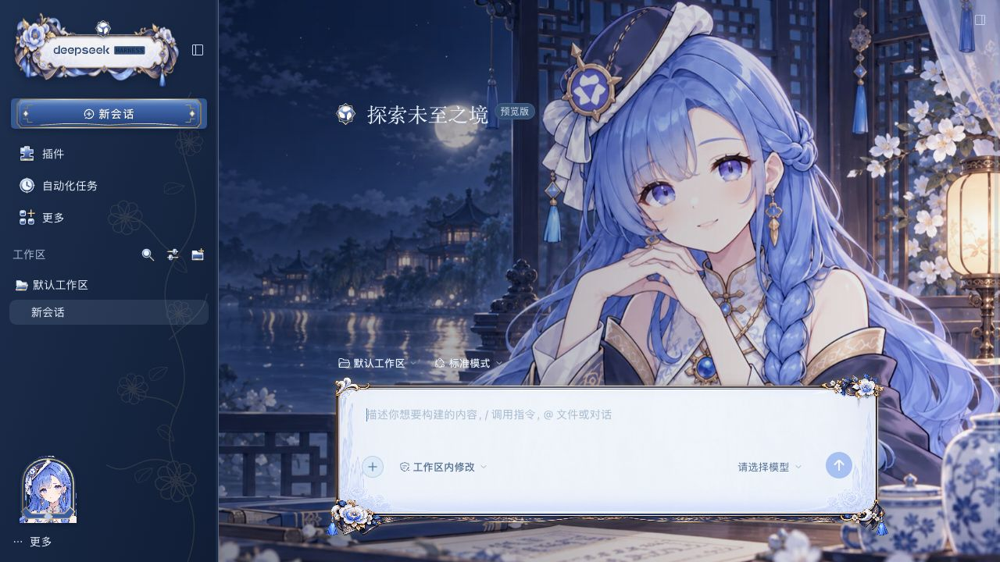
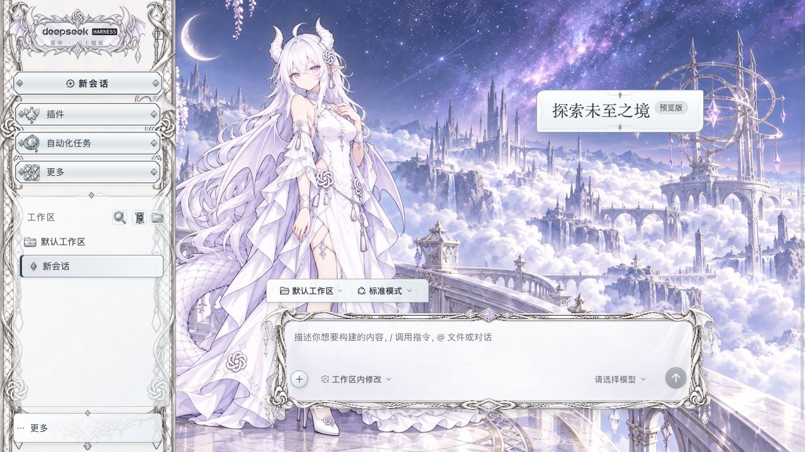
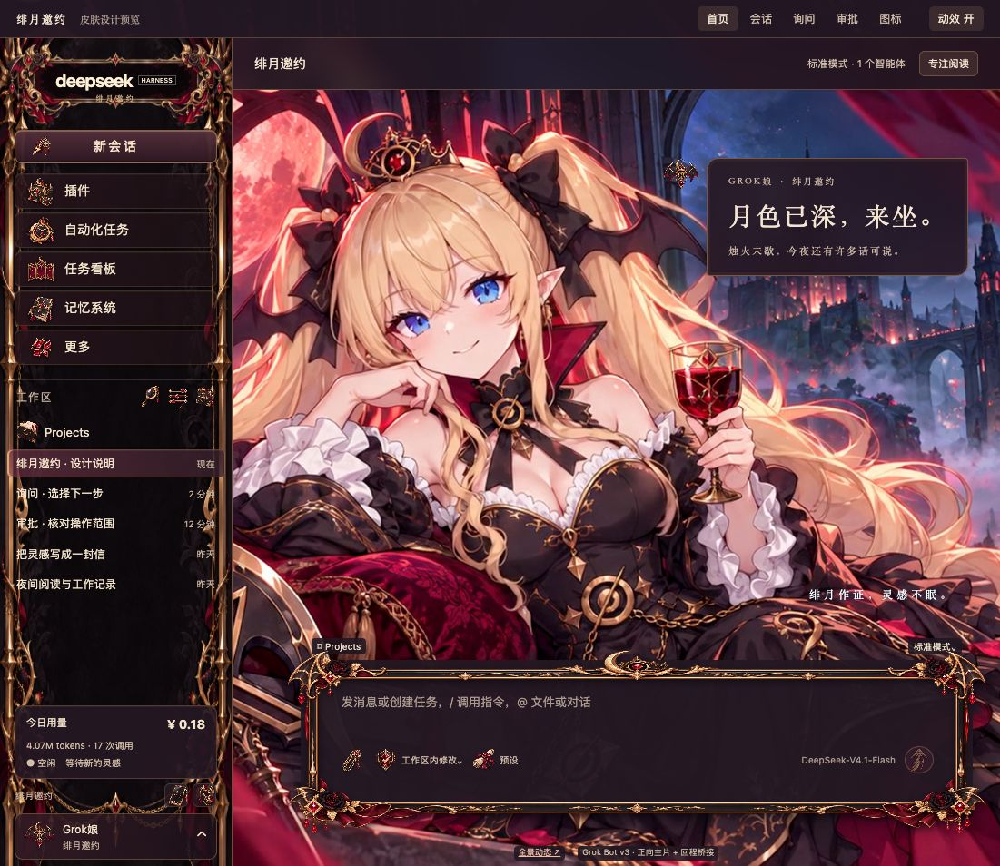

# DeepSeek Harness · 五套AI拟人娘主题皮肤

当前交付快照：2026-11-02。五套皮肤可并存，通过DSH现有皮肤中心切换。

| 主题 | 版本 | 当前背景 |
|---|---|---|
| Gemini娘 · 星光工作台 | 0.1.7 | 星夜PNG＋图片/CSS动效 |
| 千问娘 · 月下青瓷 | 0.3.1 | 16秒月夜轻动态 |
| ChatGPT娘 · 云上银庭 | 0.4.2，含当前手机工作区补丁 | 用户确认的v5c |
| DeepSeek娘 · 澄潮绮窗 | 0.2.0 | 坐姿母图v3对应的视频v4 |
| Grok娘 · 绯月邀约 | 0.2.0 | 绯月窗边母图v4对应的视频v3 |

完整工作内容、验收范围、媒体规格与缺项，见[五套皮肤工作报告](docs/五套皮肤工作报告-20261102.md)。许可按[原始声明](LICENSE-NOTICE.md)保留，不额外授予统一开源许可。

## 安装与切换

每套都是skinManifestVersion: 2的独立静态资产目录。把所选`skins/<id>/`整个文件夹复制到**当前正在运行的那一份**DSH用户目录下的`skins`，再从左下角头像 → 设置 → 皮肤，选中并激活（试穿/应用）。选择由皮肤中心保存。

整夹按发行内容原样复制，须带上随包的`skin.json`、`patches.css`和背景mp4（各套文件名以包内清单为准）。不需要复制账号、profile或制作环境。运行只使用清单声明的CSS/图片/视频，制作JS/Python留在工程侧。已有实装记录不等于全部核心版本、插件页或移动端场景均兼容。

### Mac / 默认用户目录

Mac，以及仍使用默认home的环境，用户皮肤目录是`~/.dsh/skins/`。把整夹放进这个`skins`即可。

### Windows

Windows上先查出正在运行的DeepSeek Harness的真实`DSH_HOME`（设置、启动脚本或环境变量），再把整夹复制进**该home的`skins`**。官方DeepSeek Harness「迁移版」经常单独指定`DSH_HOME`。只按`%USERPROFILE%\.dsh\skins`去装，往往会进旧目录，设置里看不到皮肤。

2026-11-04在一台Windows实机上量到的迁移版皮肤目录是：

`D:\dsh-desktop-data\official-0.2.0-rc.2-20261011\skins\`

这是该机当时的路径，其他机器的盘符和文件夹名会不同。以本机查到的`DSH_HOME`为准。

旧壳DSHLauncher（约0.1.7）和官方DeepSeek Harness迁移构建（该机文件版本FileVersion 0.2.1-rc.5）可以各有自己的home。皮肤进了另一份home时，设置 → 皮肤里不会出现，也无法使用。月下青瓷在官方迁移构建上可以激活并显示背景，前提是整夹放进那一份正在运行的`skins`。

动态背景：先关掉会盖掉主题壁纸的第三方桌面壁纸软件（例如Wallpaper Engine）。Windows若打开「减少动态效果」，背景会退回静态主视觉；这是系统降级显示，皮肤包本身仍然完整。

版本记录（Windows实机，2026-11-04）：官方迁移构建FileVersion 0.2.1-rc.5上已确认可用。该迁移home里见到的皮肤中心版本是0.4.6。仓库里较早的记录（DSH 0.2.1-rc.3、皮肤中心0.4.8）仍是另一套环境的检查结果，不表示这台Windows迁移版的皮肤中心必须是0.4.8。

## 目录

- skins/：当前发布/安装入口。
- source-projects/：源码、母图、提示词与设计预览，内含对齐的当前skin镜像；早期设计页按历史保留。
- docs/history/：过程与交付记录。
- docs/current-overrides/：ChatGPT同版当前手机补丁的差异说明。
- animation/chatgpt-v5c/：收到的动画加工资料与缺项。

ChatGPT的样式入口为skin-inkwhite.css和patches-inkwhite.css，不要统一改写成skin.css。DeepSeek/Grok可在各工程目录运行python3 -X utf8 source/build.py重建；背景视频作为已交付输入保留。上游生视频中间数据的缺项不影响现有本体运行，具体见工作报告。

## 查看设计预览

在仓库根目录运行python3 -m http.server 8771 --bind 127.0.0.1，然后打开：

- Gemini：/source-projects/dsh-gemini-skin/design-20261028/index.html
- 千问：/source-projects/dsh-qianwen-skin/design-20261029/preview/index.html
- ChatGPT：/source-projects/dsh-chatgpt-skin/design-20261029/preview/index.html
- DeepSeek：/source-projects/dsh-deepseek-skin/design-20261102/preview/index.html
- Grok：/source-projects/dsh-grok-skin/design-20261102/preview/index.html

这些是制作/设计预览，示例余额、模型或审批内容不代表真实运行事件。原生账号/会话截图、完整历史、运行日志和本机备份不入库。

## 随包预览图

Gemini：审批样式预览。

千问：月下青瓷。

ChatGPT：珍珠白与黑边纹。

DeepSeek：海馆藏珍v0.2。

Grok：黑金绯月v0.2。

